# Customer Churn Intelligence Platform

A local decision-support application for telco churn. It scores the IBM Telco Customer Churn table, explains each score, and turns the result into a review queue. It does not change a price, deny service, or treat customers differently because of gender or senior-citizen status.

The running demo uses all 7,043 customer records. Observed churn is 1,869 / 7,043 (26.5%). Month-to-month customers churn at 1,655 / 3,875 (42.7%). Two-year customers churn at 48 / 1,695 (2.8%).

## Contents

- [Application preview](#application-preview)
- [Feature gallery](#feature-gallery)
- [Business problem](#business-problem)
- [Features](#features)
- [Architecture](#architecture)
- [Technology stack](#technology-stack)
- [Machine learning](#machine-learning)
- [Segments and customer profiles](#segments-and-customer-profiles)
- [Explainability](#explainability)
- [Retention and business impact](#retention-and-business-impact)
- [Installation](#installation)
- [Configuration](#configuration)
- [Docker](#docker)
- [API](#api)
- [Tests](#tests)
- [Dataset](#dataset)
- [Security](#security)
- [Limitations and next steps](#limitations-and-next-steps)

## Application preview

These views were captured from the running app on 17 October 2026, in the light theme, at a 1440px desktop width. The API reported the model loaded and 7,043 customers.

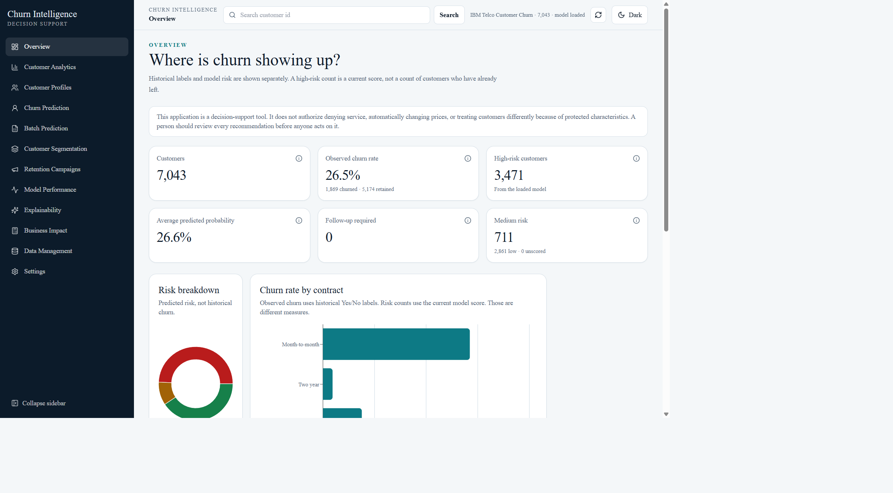

Overview: 7,043 customers, 26.5% observed churn, 3,471 high-risk scores, and the contract chart. Observed churn and predicted risk are labeled separately.

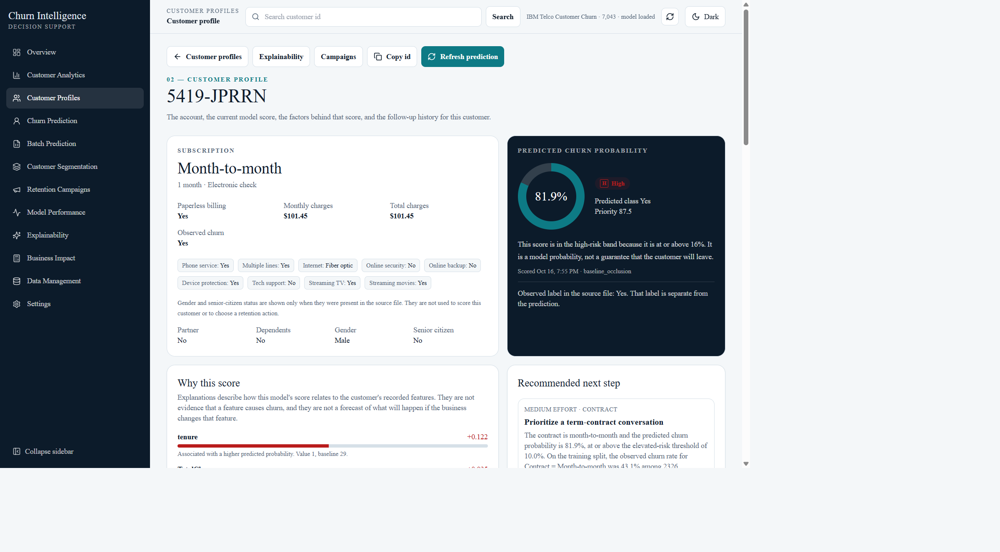

Customer profile for `5419-JPRRN`: month-to-month, $101.45, observed churn Yes, predicted probability 81.9% (high), baseline-occlusion factors, and the recommended next step. The contacted follow-up for this customer is on the retention page below.

## Feature gallery

### Analytics and customer profiles

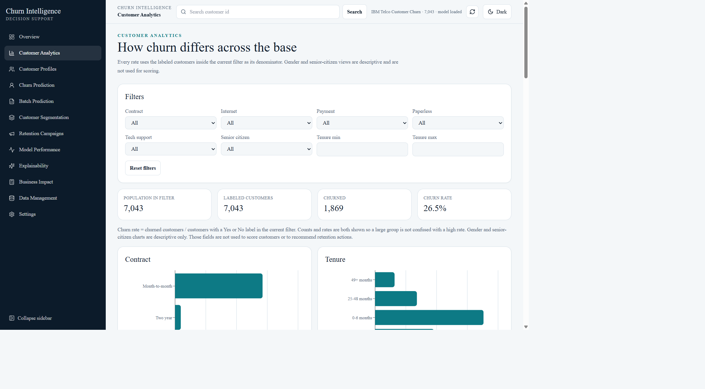

Filters and rates for the labeled population. The denominator is the customers inside the current filter.

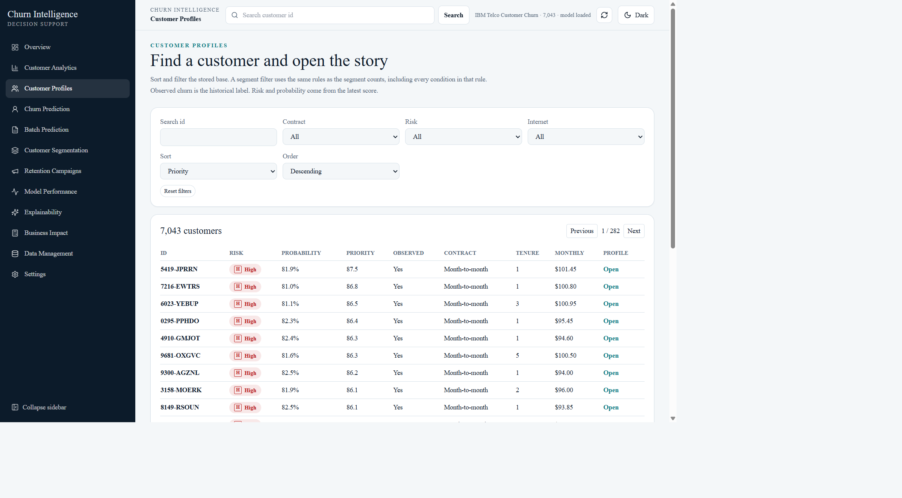

The directory lists the same 7,043 records. `5419-JPRRN` is the first row when sorted by priority.

### Prediction and segmentation

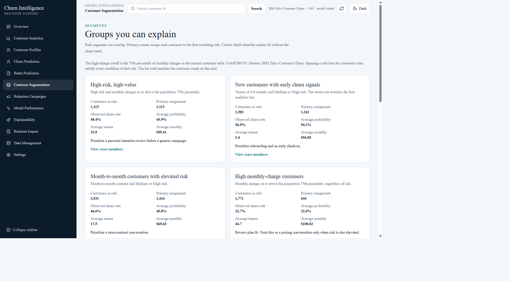

Rule cards use one classifier for the count and the member list. Primary assignments are disjoint and sum to 7,043.

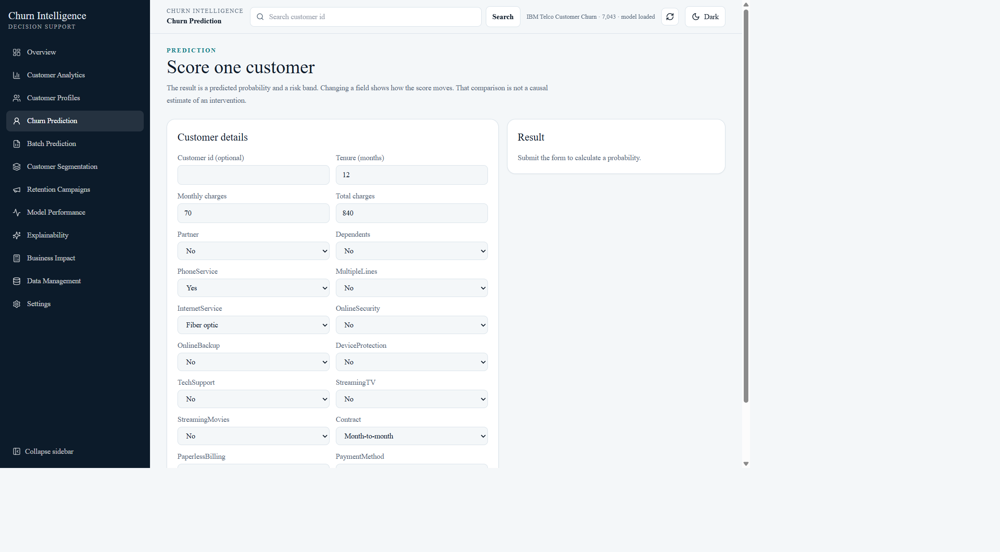

The form is ready to score one customer. This capture was taken before submit, so the demo database was not changed.

### Retention operations

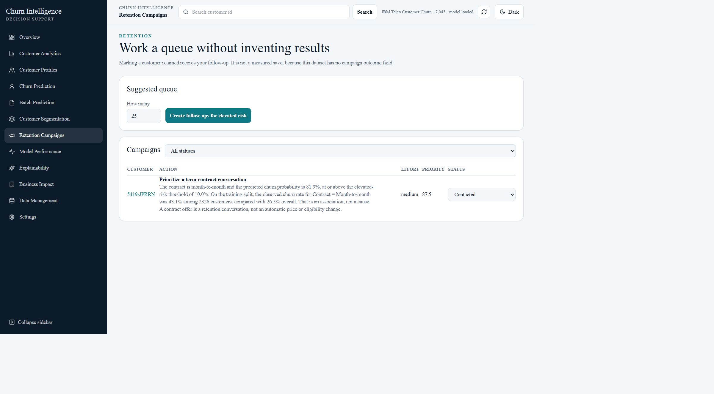

The existing follow-up for `5419-JPRRN` is still Contacted. Status is a user record, not a measured save.

### Model evaluation and explainability

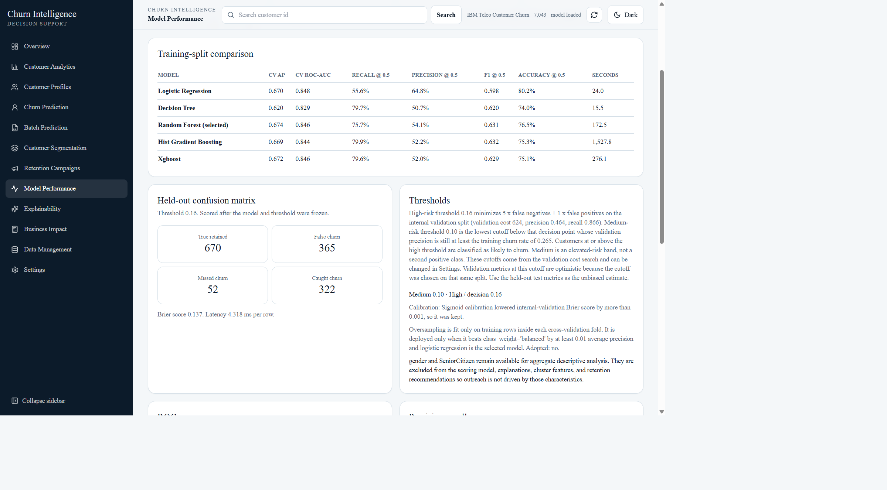

Decision threshold 0.16. Held-out counts are 670 true retained, 365 false churn, 52 missed churn, and 322 caught churn.

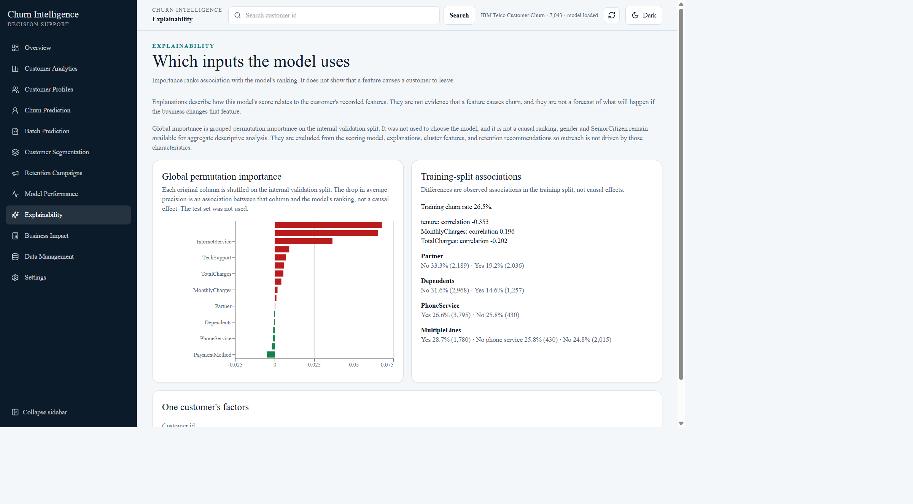

Global importance is permutation importance on the internal validation split. It was not used to choose the model. Local factors on a profile use baseline occlusion.

### Business impact and responsive design

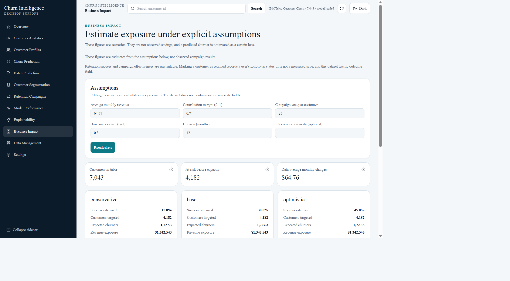

Inputs are editable assumptions. The dollar figures are scenarios, not observed savings.

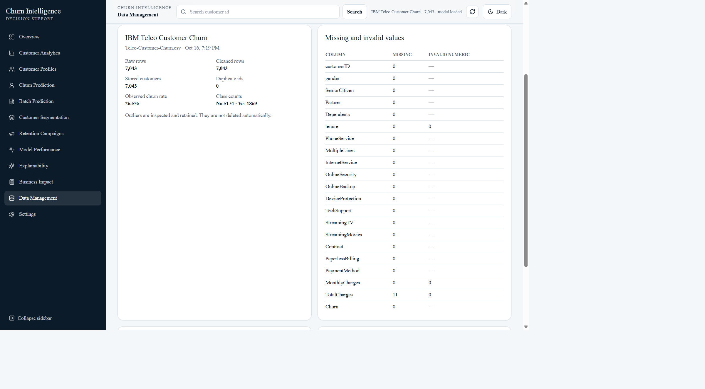

The IBM file has 7,043 rows, 1,869 churned customers, and 11 blank `TotalCharges` values on tenure-0 accounts. Those totals are kept as 0.

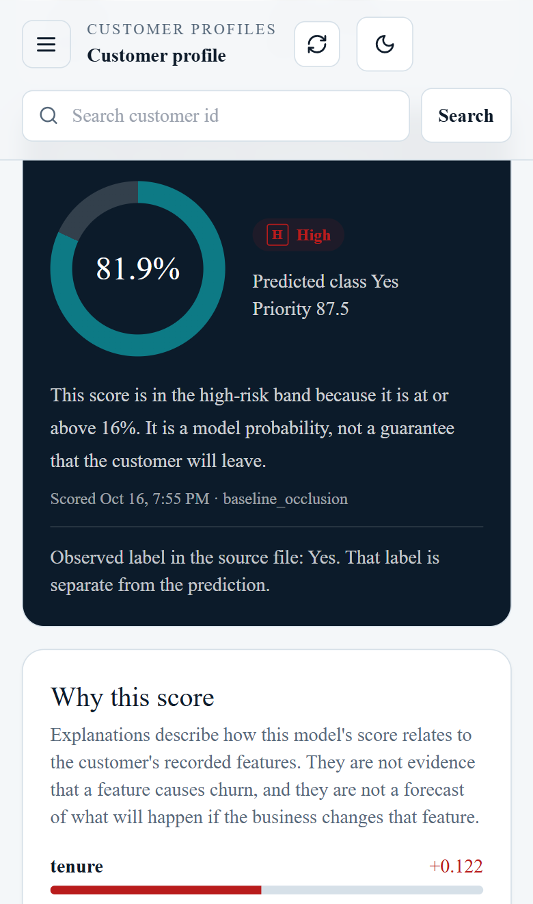

At about 390px the sidebar becomes a menu button. The same `5419-JPRRN` profile shows the 81.9% score and the baseline-occlusion note.

## Business problem

A retention team has a snapshot of phone and internet customers and a historical churn label. The useful question is which current customers resemble the people who left, which recorded fields move the score, and which contract or service action is worth a human review.

The application keeps observed churn and predicted risk separate. A high score is a model probability, not a certainty that the customer will leave. Financial figures are scenarios from assumptions the user can edit. They are not measured campaign savings.

## Features

- Data-quality report for missing values, blank `TotalCharges`, duplicate ids, and outliers that are flagged and kept.
- Analytics charts that show both the count and the rate, with the filtered labeled population as the denominator.
- Five classifiers compared on training-split average precision. Random forest is the saved model.
- Individual and batch scoring. Invalid CSV rows stay in the result with the reason they were not scored.
- Customer profiles at `/customers/{id}` with the stored subscription, the latest score, factors, and follow-up history.
- Rule segments whose directory lists use the same classifier as the segment counts.
- A retention queue with persisted statuses: follow-up required, contacted, offer proposed, and retained.
- Conservative, base, and optimistic impact scenarios. Campaign success is labeled unavailable because the file has no outcome field.
- Light and dark themes, and a collapsible navigation drawer on narrow screens.

## Architecture

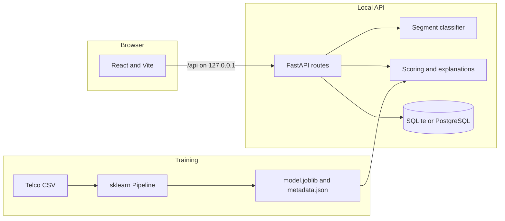

The browser does not calculate probabilities. Training writes artifacts. The API loads the configured joblib file once and never unpickles an upload. More detail is in [docs/architecture.md](docs/architecture.md).

## Technology stack

| Layer | Choice |
| --- | --- |
| API | Python 3.11, FastAPI, Pydantic, SQLAlchemy |
| Data and models | pandas, scikit-learn, XGBoost, joblib |
| Explanations | SHAP when the estimator supports it and the values reconcile; otherwise baseline occlusion |
| UI | React, TypeScript, Vite, Tailwind CSS, Recharts |
| Tests | pytest, Vitest, Testing Library |
| Local packaging | Docker Compose, GitHub Actions workflow file |

## Machine learning

Training splits the labeled table before any imputer, encoder, or model is fit.

1. Hold out 20% stratified as the test set (1,409 rows).
2. Split the remainder 75/25 into train (4,225) and internal validation (1,409).
3. Compare logistic regression, a decision tree, random forest, histogram gradient boosting, and XGBoost with 3-fold cross-validated average precision on the training split only.
4. Keep sigmoid calibration when it lowers validation Brier by more than 0.001.
5. Choose the positive-class threshold on the validation split by minimizing `5 × false negatives + 1 × false positives`. That 5:1 ratio is an assumption, not a measured cost.
6. Refit the selected calibrated pipeline on train plus validation, then evaluate the frozen 0.16 threshold once on the test set.

| Model | CV average precision | CV ROC-AUC | Recall at 0.5 |
| --- | ---: | ---: | ---: |
| Logistic regression | 0.6696 | 0.8482 | 0.5558 |
| Decision tree | 0.6205 | 0.8292 | 0.7975 |
| Random forest, selected | 0.6736 | 0.8463 | 0.7574 |
| HistGradientBoosting | 0.6693 | 0.8442 | 0.7993 |
| XGBoost | 0.6724 | 0.8462 | 0.7957 |

Held-out test metrics for the refit random forest at threshold 0.16, read from `ml/artifacts/metadata.json`:

| Metric | Value |
| --- | ---: |
| Average precision | 0.6521 |
| ROC-AUC | 0.8441 |
| Precision | 0.4687 |
| Recall | 0.8610 |
| F1 | 0.6070 |
| Accuracy | 0.7040 |
| Brier | 0.1366 |

The confusion matrix is 670 true retained, 365 false churn flags, 52 missed churners, and 322 caught churners. Of the 687 customers flagged at or above 0.16, 53.1% were labeled retained. Accuracy is below a majority-class baseline of about 73.5% because the cutoff is chosen to catch churn, not to maximize accuracy.

Validation labels were used to choose calibration and the threshold, so validation metrics at 0.16 are optimistic. The split is one random sample of one historical snapshot. There is no event date, so the split is not temporal. The full method is in [docs/ml-methodology.md](docs/ml-methodology.md).

`gender` and `SeniorCitizen` stay in descriptive charts. They are excluded from the model, explanations, clusters, and recommendations.

## Segments and customer profiles

Rule segments can overlap. The card count and `GET /api/customers?segment=` use one classifier, so the directory lists customers who satisfy every condition of that rule. `total` is the count after any extra directory filters. `segment.members` is the full rule size. With no extra filters, those two counts match. An unknown segment id returns HTTP 400.

On the current 7,043-row table the high-charge cutoff is the 75th percentile of monthly charges, 89.85. Primary assignment gives each customer the first matching rule. Those exclusive counts sum to 7,043.

Opening a customer id loads `/customers/{id}`: the stored subscription, the latest probability and risk band, the factors behind that score, and any saved follow-up. Observed churn remains the historical label and is shown separately from the prediction.

## Explainability

For one customer the service tries SHAP and keeps it only when the explanation reconciles with the predicted probability within 0.08. The saved model is a sigmoid-calibrated pipeline, which is not a SHAP-supported estimator, so customer and batch explanations for this artifact use baseline occlusion. Each feature is replaced with its training baseline and the change in predicted probability is recorded. No SHAP value is invented.

Global importance is grouped permutation importance on the validation split. It was not used to choose the model, and it is not a causal ranking. Changing a field on the prediction form shows how this model responds. It does not estimate the effect of a real intervention.

## Retention and business impact

A follow-up stores an action, a reason, and a status. The statuses are user records. Marking someone retained does not measure a save, because the IBM file has no campaign-outcome field.

Impact scenarios use editable assumptions. The stored demo assumptions are average monthly revenue 64.77, contribution margin 0.70, campaign cost 25, success rate 0.30, and a 12-month horizon. Targeted customers are Medium and High risk. Expected churners are the sum of predicted probabilities, not a count of certain losses. The formulas are in [docs/business-metrics.md](docs/business-metrics.md).

## Installation

Requires Python 3.11+ and Node.js 20+.

### Windows PowerShell

```powershell
py -3.11 -m venv .venv
.\.venv\Scripts\python.exe -m pip install -r backend\requirements-dev.txt
.\.venv\Scripts\python.exe scripts\download_data.py
.\.venv\Scripts\python.exe -m ml.training.train
.\.venv\Scripts\python.exe -m uvicorn app.main:app --app-dir backend --host 127.0.0.1 --port 8000
```

In a second terminal:

```powershell
cd frontend
npm ci
npm run dev
```

Open `http://127.0.0.1:5173`. The Vite dev server proxies `/api` to `http://127.0.0.1:8000`.

### Linux and macOS

```bash
python3.11 -m venv .venv
source .venv/bin/activate
python -m pip install -r backend/requirements-dev.txt
python scripts/download_data.py
python -m ml.training.train
python -m uvicorn app.main:app --app-dir backend --host 127.0.0.1 --port 8000
```

```bash
cd frontend
npm ci
npm run dev
```

If the download fails, place `Telco-Customer-Churn.csv` in `data/raw` and rerun training. If the model file is missing, the API still starts. Data Management can import a CSV, and scores appear after training and **Reload model and rescore** in Settings.

`scripts/start-api.ps1` starts the API on `127.0.0.1:8000`.

## Configuration

Copy `.env.example` to `.env`. Every value is optional.

| Variable | Default | Purpose |
| --- | --- | --- |
| `DATABASE_URL` | SQLite at `data/app.db` | SQLite or `postgresql+psycopg://...` |
| `CORS_ORIGINS` | localhost and `127.0.0.1` on port 5173 | Allowed browser origins. Credentialed CORS is off. |
| `MODEL_PATH` | `ml/artifacts/model.joblib` | Only path the API will unpickle |
| `METADATA_PATH` | `ml/artifacts/metadata.json` | Metrics and feature specification |
| `SEGMENTS_PATH` | `ml/artifacts/segments.joblib` | Optional k-means artifact |
| `DATA_CSV_PATH` | `data/raw/Telco-Customer-Churn.csv` | Startup import when the customer table is empty |
| `MAX_UPLOAD_MB` | 10 | CSV upload limit, plus 1 MB for multipart framing |
| `AUTO_IMPORT` | true | Import the configured CSV only when the table is empty |
| `VITE_API_PROXY` | `http://localhost:8000` | Dev-server proxy target. Not shipped in the browser bundle. |
| `VITE_DEV_PORT` | 5173 | Dev-server port |

The CSV, the trained artifacts, `data/app.db`, and `.env` are gitignored.

## Docker

Train on the host first so `data/raw` and `ml/artifacts` exist, then:

```bash
docker compose up --build
```

Compose publishes the UI on `127.0.0.1:5173` and the API on `127.0.0.1:8000`. Inside the Compose network the API listens on all container interfaces so the UI container can reach `backend:8000`. The host mounts `./data` and `./ml/artifacts`.

`docker compose config` parses. On 17 October 2026 the Docker client was installed and the daemon was not running (`dockerDesktopLinuxEngine` was missing), so the images were not built and the containers were not started. Treat the Compose file as reviewed configuration, not a verified runtime.

## API

Base path `/api`. Interactive schema: `http://127.0.0.1:8000/docs` while the API is running. The endpoint table is in [docs/api.md](docs/api.md).

| Method | Path | Purpose |
| --- | --- | --- |
| GET | `/health` | Model and dataset status |
| GET | `/customers` | Directory. `segment` uses the exact rule membership. |
| GET | `/customers/{customer_id}` | Profile, score, history, campaigns |
| POST | `/predictions/single` | One score, factors, and actions |
| POST | `/predictions/batch` | CSV upload. Invalid rows are kept. |
| GET | `/analytics/segments` | Rule counts and cluster profiles |
| GET | `/models/performance` | Comparison and held-out metrics |
| GET | `/explanations/global` | Permutation importance |
| GET, POST, PATCH | `/campaigns` | Follow-up records |
| GET | `/business-impact` | Scenario estimates |
| GET, PUT | `/settings` | Thresholds and financial assumptions |

Errors return `{ "code", "message" }`. Validation errors add `type`, `loc`, and `msg` only. Stack traces are not returned.

## Tests

From the repository root:

```powershell
.\.venv\Scripts\python.exe -m pytest
```

From `frontend/`:

```powershell
npm run typecheck
npm test
npm run build
```

Backend tests use a synthetic fixture and a logistic-regression pipeline fit inside the test session. They do not read the IBM artifact or `data/app.db`. Frontend tests mock `fetch`.

Latest local run on 17 October 2026:

| Check | Result |
| --- | --- |
| `.\.venv\Scripts\python.exe -m pytest` | 24 passed, 4 warnings, 77.77s |
| `npm run typecheck` | passed |
| `npm test` | 10 passed |
| `npm run build` | passed in 11.74s. One large bundle warning. |
| `GET /api/health` | HTTP 200, model loaded, 7,043 customers |

The four pytest warnings are a Starlette note about `httpx` and a SHAP colormap deprecation. They do not fail the suite.

GitHub Actions, in `.github/workflows/ci.yml`, runs pytest on Python 3.11 and the frontend typecheck, Vitest suite, and production build on Node 20. [Run 1](https://github.com/karthik2104-cr/Customer-Churn-Intelligence-Platform/actions/runs/38966344163) for `873a743` and [run 2](https://github.com/karthik2104-cr/Customer-Churn-Intelligence-Platform/actions/runs/38966729190) for `d8a968b` both completed with success on the backend and frontend jobs.

## Dataset

The file is the public IBM telco sample published in [telco-customer-churn-on-icp4d](https://github.com/IBM/telco-customer-churn-on-icp4d). The same table is listed as [Telco Customer Churn on Kaggle](https://www.kaggle.com/datasets/blastchar/telco-customer-churn). `scripts/download_data.py` downloads the IBM CSV. This repository does not commit the CSV, the trained `model.joblib`, or the local SQLite database. Follow the license on the IBM repository before redistributing the file.

A synthetic generator exists for tests (`ml/data/synthetic.py`). Its ids start with `SYN-`. The UI labels that file as synthetic. It is not the IBM dataset.

## Security

There is no authentication or authorization. The documented API command binds to `127.0.0.1`. Do not publish it on a public interface.

- CORS origins come from `CORS_ORIGINS`. Credentialed browser calls are disabled.
- Uploaded filenames are reduced to a `.csv` basename and are not opened as filesystem paths.
- Request bodies larger than the upload limit plus 1 MB of multipart framing are rejected before the CSV is parsed.
- CSV cells that start with `=`, `+`, `-`, `@`, or a tab are prefixed on export so a spreadsheet does not treat them as formulas.
- The model file is loaded only from the configured path. Uploads are never unpickled.
- Error responses omit stack traces, submitted values, and the model filesystem path.

These controls keep a local tool from mishandling a filename or a stack trace. They are not a production security review.

## Limitations and next steps

- The file has no event date, so there is no monthly churn trend and the evaluation split is not temporal.
- Follow-up statuses are user records. There is no measured save rate.
- Financial results are scenarios. They are not observed savings.
- The 0.16 threshold favors recall under an assumed 5:1 cost ratio.
- Explanations for the calibrated forest are baseline occlusion, not SHAP.
- Docker images have not been built in this environment because the daemon was not running.
- GitHub Actions runs 1 and 2 completed successfully. A later documentation push starts a new run; that run is confirmed only after GitHub reports it.
- Useful later work is authentication before any non-local deploy, a later-period evaluation, and a place to record actual campaign outcomes.
