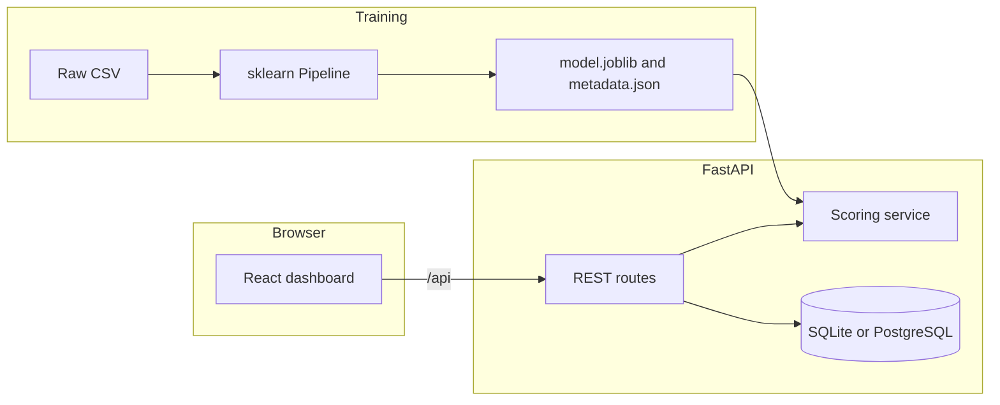

# Architecture

The platform is a local decision-support application. The browser talks to a FastAPI service. That service loads one trained pipeline at startup and reads a SQLite database (PostgreSQL is supported through `DATABASE_URL`).

## Boundaries

- `data/raw` holds the source CSV. `data/processed` holds the trainable table written by training. `ml/artifacts` holds the model, metrics, and EDA report.
- `ml/` owns loading, cleaning, training, evaluation, explanations, segments, and financial formulas. It does not import the web app.
- `backend/app` owns HTTP, persistence, and the runtime that loads the artifact once.
- `frontend/` renders the API. It does not calculate churn probabilities. The shell is a navy sidebar with teal actions, a light surface theme, and a dark theme stored in the browser. Customer profiles are a dedicated route, `/customers/{id}`.

## Request path

1. Startup creates tables, loads `model.joblib` with joblib from the configured path, and imports the configured CSV when the customer table is empty.
2. Import scores are written in one batch without per-row explanations.
3. A single prediction or a customer-detail refresh explains that one row, trying SHAP and falling back to baseline occlusion. The calibrated forest used here falls back to occlusion.
4. `GET /api/customers?segment=` and the segment cards call the same rule classifier. Extra directory filters narrow the list after membership is known. `total` and `segment.members` match when no extra filter is set.
5. Campaign status changes and business-impact assumptions are stored in the database. Threshold edits relabel stored scores without retraining.

## Local safety boundary

The documented server binds to `127.0.0.1`. There is no login. Uploads are size-limited, accepted only as `.csv`, and stored under a basename rather than a caller-supplied path. Validation and unexpected errors returned to the client omit stack traces and submitted values. Compose publishes host ports on `127.0.0.1` only. That container runtime has not been started in this environment.

## What is not in the system

There is no authentication. Do not expose the API on a public network. There is no campaign-outcome table in the IBM file, so retention success stays labeled unavailable.
